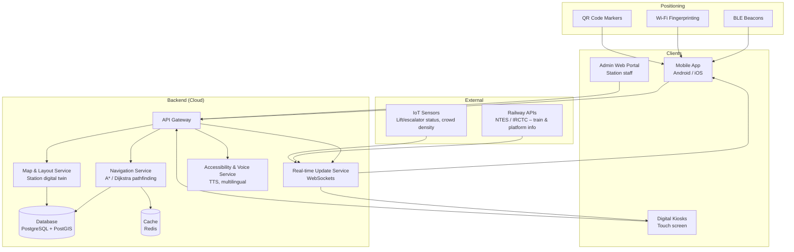

# Smart India Hackathon Workshop
# Date: 26-10-2026
## Register Number: 212224040312
## Name: A. Sherwin Infano
## Problem Title
SIH 1710: Enhancing Navigation for Railway Station Facilities and Locations
## Problem Description
Background: Railway stations are complex environments with numerous facilities and locations such as ticket counters, platforms, restrooms, food courts, and waiting areas. Passengers often face difficulties in navigating these spaces, especially in large or unfamiliar stations. Efficient and user-friendly navigation systems are crucial for improving passenger experience, reducing congestion, and ensuring timely travel connections. Description: The problem involves developing a comprehensive navigation solution for railway stations that assists passengers in locating various facilities and destinations within the station premises. This includes creating detailed maps, providing real-time directions, and integrating features such as accessibility options for individuals with disabilities. The solution should be intuitive, easy to use, and accessible via multiple platforms, including mobile devices and digital kiosks. Key challenges include updating navigation information in real-time, ensuring accuracy, and accommodating the diverse needs of all passengers. Expected Solution: The expected solution is a multi-platform navigation system that provides detailed, real-time directions to all facilities and locations within a railway station. This system should include: A mobile application with 3D interactive maps and step-by-step navigation. Digital kiosks located throughout the station with touch-screen interfaces. Voice-guided navigation for visually impaired passengers. Regular updates to reflect changes in station layout and facility locations. Integration with existing railway apps and services for seamless user experience. The solution should enhance the overall passenger experience by reducing confusion, saving time, and improving accessibility within the station.

## Problem Creater's Organization
Ministry of Railway

## Idea
**RailNav – Smart Indoor Navigation for Railway Stations**

RailNav is a multi-platform indoor navigation system that guides passengers from wherever they are in a station to any facility — platforms, ticket counters, restrooms, food courts, waiting rooms, cloak rooms, lifts, escalators and exits — using interactive 2D/3D maps, turn-by-turn directions and voice guidance.

Since GPS does not work reliably inside large station buildings, RailNav combines:
- **BLE beacons / Wi-Fi fingerprinting** for indoor positioning,
- **QR codes** at key points as a zero-hardware fallback ("scan to locate me"),
- **A digital twin of the station** (floor plans converted into a graph of walkable paths),
- **Live data feeds** (train platform changes, lift/escalator status, crowd density) to keep routes accurate in real time.

Key highlights:
- Step-by-step navigation on mobile with 3D floor maps.
- Touch-screen kiosks at entrances and concourses with "send route to phone" via QR.
- Voice-guided and high-contrast modes for visually impaired passengers; step-free (wheelchair) routing that avoids stairs.
- Multilingual support (English, Hindi and regional languages).
- Platform-aware routing: enter a PNR or train number and get directed straight to the correct platform and coach position.
- An admin portal for station staff to update layouts, close paths, and mark facilities out of service instantly.

## Proposed Solution / Architecture Diagram

**How it works**
1. The station's floor plans are digitised into a graph (nodes = facilities, junctions, lifts, stairs; edges = walkable paths with distance and accessibility tags).
2. The passenger's location is estimated using beacons/Wi-Fi, or set manually by scanning a nearby QR code or picking a point on the map.
3. The passenger chooses a destination (facility, platform, or train number/PNR).
4. The Navigation Service computes the best route using A* search, applying filters such as step-free only, least crowded, or shortest.
5. Directions are shown as turn-by-turn steps on the 3D map and optionally read aloud.
6. Live events (platform change, lift out of service, congestion) are pushed over WebSockets and the route is recalculated automatically.

## Use Cases
1. **Finding the right platform:** A passenger enters a train number or PNR; the app shows the platform, coach position and the quickest route from their current location.
2. **Locating facilities:** Quickly find the nearest restroom, drinking water, food court, ATM, waiting room, cloak room or ticket counter.
3. **Accessible navigation:** Wheelchair users and elderly passengers get step-free routes using lifts and ramps; visually impaired passengers get voice-guided navigation with audio cues.
4. **First-time / non-local visitors:** Multilingual interface and kiosks at entrances help tourists and first-time travellers orient themselves.
5. **Real-time rerouting:** If a platform changes or an escalator is under maintenance, the user is automatically notified and rerouted.
6. **Kiosk-to-phone handoff:** A passenger plans a route on a kiosk and scans a QR code to continue navigation on their phone.
7. **Emergency evacuation:** In emergencies, the system shows the nearest safe exits and assembly points.
8. **Station management:** Staff use the admin portal to update layouts, mark closed areas, and view crowd heatmaps for better crowd control.

## Technology Stack
| Layer | Technologies |
|---|---|
| Mobile App | Flutter (Android & iOS), Mapbox / Unity for 3D indoor maps |
| Kiosk & Admin Portal | React.js, Three.js (3D map rendering) |
| Backend | Node.js (Express) / Python (FastAPI), REST + WebSockets |
| Pathfinding | A* / Dijkstra on station graph (NetworkX for modelling) |
| Database | PostgreSQL with PostGIS (spatial data), Redis (caching) |
| Indoor Positioning | BLE beacons, Wi-Fi RSSI fingerprinting, QR code markers |
| Voice & Language | Google Text-to-Speech / Speech-to-Text, Bhashini for Indian languages |
| Real-time Data | Railway APIs (NTES / IRCTC), IoT sensors via MQTT |
| Cloud & DevOps | AWS / Azure, Docker, GitHub Actions (CI/CD) |
| Authentication | Firebase Auth / OAuth 2.0 (admin portal) |

## Dependencies
**Hardware**
- BLE beacons installed across concourses, platforms and corridors
- Touch-screen digital kiosks at entrances and major junctions
- QR code markers at key points (platform ends, stairways, entrances)
- IoT sensors for lift/escalator status and crowd counting (optional, for live updates)

**Software / Data**
- Accurate, digitised floor plans of each station
- Access to railway APIs for train schedules and platform allotments
- Map SDK (Mapbox / Unity) and 3D rendering libraries
- Text-to-speech and translation services
- Cloud hosting for backend services and database

**Organisational**
- Cooperation from Ministry of Railways / station authorities for data access and hardware installation
- Station staff to keep layout and facility information updated via the admin portal
